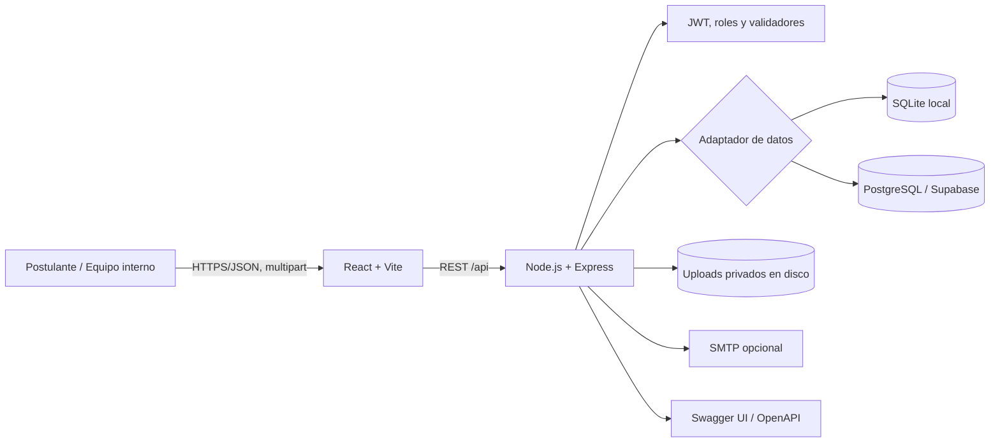
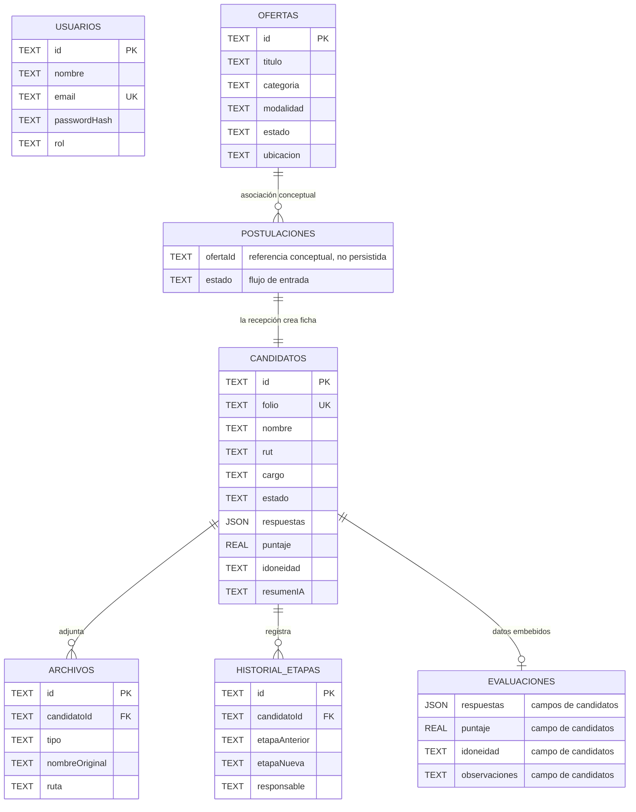

# Documento técnico EA3 — DSY1104

## 1. Propósito y arquitectura

Aquachile-EV-Psicolaboral es una aplicación web monolítica Full Stack: una interfaz React 18 compilada con Vite se comunica por HTTP/JSON con una API Node.js 24 y Express. El mismo backend contiene controladores, validaciones, servicios y acceso a datos. La persistencia se implementa con SQLite local (`node:sqlite`) o PostgreSQL (`pg`) seleccionado mediante `DATABASE_URL`; el esquema y las funciones de acceso se mantienen en ambos adaptadores. Vite funciona como servidor de desarrollo separado. En despliegue, Express puede servir `frontend/dist` con `SERVE_FRONTEND=true`.



## 2. Datos y relaciones

SQLite y PostgreSQL definen tablas físicas `usuarios`, `candidatos`, `archivos`, `historial_etapas` y `ofertas`. Las referencias físicas de `archivos.candidatoId` y `historial_etapas.candidatoId` apuntan a `candidatos.id`. La postulación es el flujo de entrada que crea un candidato; no hay una tabla física `postulaciones` en el esquema actual. Los resultados de evaluación y el resumen IA se guardan como campos de `candidatos` (no como tabla independiente). La oferta tampoco tiene una FK de candidato: el cargo y la familia se conservan en la ficha del candidato.



**Lectura del MER:** `POSTULACIONES` y `EVALUACIONES` se muestran como entidades funcionales para explicar el proceso solicitado, pero no son tablas físicas del esquema actual. La primera representa la solicitud recibida y crea una ficha `CANDIDATOS`; la segunda agrupa respuestas, puntaje, dimensiones, idoneidad y observaciones almacenadas en esa ficha. `OFERTAS` se administra por separado: `ofertaId` no está persistido y no existe FK entre oferta y candidato en esta versión. `ARCHIVOS` es la tabla física de documentos.

## 3. API REST, documentación y seguridad

La especificación OpenAPI 3.0.3 está centralizada en `backend/src/docs/openapi.js`. Al iniciar la API están disponibles Swagger UI en `/api-docs` y su documento JSON en `/api-docs.json`.

| Área | Rutas verificadas | Acceso |
|---|---|---|
| Autenticación | `POST /api/auth/login`, `GET /api/auth/perfil` | Login público; perfil con JWT |
| Ofertas | `GET /api/ofertas/publicas`, `GET /api/ofertas/publicas/:id` | Público; acepta búsqueda y filtros |
| Administración de ofertas | `GET/POST /api/ofertas`, `PUT/DELETE /api/ofertas/:id`, `PATCH /api/ofertas/:id/estado` | JWT; escritura requiere rol `psicologo` |
| Postulación y consulta | `POST /api/postulaciones`, `POST /api/postulaciones/consulta` | Pública; postulación `multipart/form-data` |
| Candidatos | `GET /api/candidatos`, `GET /api/candidatos/:id`, `GET /api/candidatos/:id/cv`, `GET /api/candidatos/:id/historial`, `GET /api/candidatos/:id/informe.pdf` | JWT; descarga privada |
| Evaluación y apoyo | `POST /api/candidatos/:id/evaluacion`, `POST /api/candidatos/:id/asistente`, `GET /api/candidatos/comparar` | JWT; cambios reservados al evaluador |
| Catálogos | `GET /api/catalogos`, `GET /api/catalogos/evaluacion` | Catálogo público; cuestionario requiere JWT |

Los endpoints de escritura y los reportes detallados se validan en servidor. Las respuestas de error usan estados HTTP como 400 (entrada inválida), 401 (sin sesión), 403 (rol insuficiente), 404 (recurso no disponible) y 500 (error interno). JWT se envía en `Authorization: Bearer <token>`. Los roles existentes son `analista` (consulta, descarga y exportación) y `psicologo`/evaluador (además puede crear, editar, evaluar, cambiar estado y eliminar). La consulta pública por folio y RUT devuelve datos mínimos del proceso.

La postulación adjunta CV PDF/DOC/DOCX y admite antecedentes PDF/DOC/DOCX/XLSX, sujetos al límite de `LIMITE_ARCHIVO_MB` (5 MB por defecto). Se validan campos de perfil, formato y tipo MIME; la evaluación valida que todas las respuestas estén dentro de la escala configurada y que las observaciones no superen 1.000 caracteres.

## 4. Archivos privados de candidatos

Multer guarda los documentos fuera de `frontend/public`, bajo `backend/uploads/postulantes/<nombre_normalizado>_<uuid>/`; los nombres físicos también incluyen UUID. La tabla `archivos` guarda metadatos y una ruta relativa. `GET /api/candidatos/:id/cv` exige JWT, verifica candidato, existencia del CV y ubicación dentro de la raíz privada antes de transferirlo. No se debe publicar ni versionar `backend/uploads/`. El frontend descarga el contenido autenticado como blob.

## 5. Asistencia automatizada e IA

`backend/src/services/asistente.service.js` extrae texto de PDF o DOCX cuando es posible y calcula afinidad por coincidencia de palabras del cargo/familia con el CV legible. Si no hay CV legible o falla la extracción, retorna afinidad nula y un resumen de disponibilidad limitada; el endpoint sigue respondiendo sin transformar esa falla en descarte. La salida incluye `criterios_usados` (palabras coincidentes y contexto declarado), `limitaciones` (sesgo, contexto incompleto y competencias no medidas) y `requiere_revision_humana: true`. El panel obliga a leer que es solo apoyo y nunca descarta automáticamente. El cálculo actual es una heurística textual; no debe describirse como diagnóstico ni como decisión automatizada.

## 6. Variables de entorno y ejecución

Los ejemplos no contienen secretos: `backend/.env.example` y `frontend/.env.example`. Copiar los archivos a `.env` y establecer valores locales. Entre las variables del backend están `JWT_SECRET` (obligatoria), `JWT_EXPIRES_IN`, `PORT`, `DATABASE_URL`, `DIRECTORIO_DATOS`, `DIRECTORIO_UPLOADS`, `CORS_ORIGIN`, `SERVE_FRONTEND`, `LIMITE_ARCHIVO_MB`, cuentas semilla `EVALUADOR_*`/`ANALISTA_*`, `SEED_DEMO` y configuración `SMTP_*`. El frontend usa `VITE_API_URL`, `VITE_API_PROXY_TARGET` y `VITE_PORT`. No registrar `.env`, contraseñas, archivos CV ni bases de datos locales.

Desde la raíz del repositorio, con Node.js 24 o superior:

```powershell
npm run setup
Copy-Item backend/.env.example backend/.env
Copy-Item frontend/.env.example frontend/.env
```

Completar `JWT_SECRET`, `EVALUADOR_PASSWORD` y `ANALISTA_PASSWORD` con valores locales. Para modo local se puede dejar `DATABASE_URL` vacío: el backend crea `backend/data/aquachile.db` y carga los datos semilla si corresponde. SQLite permite ejecutar y demostrar la aplicación sin credenciales de nube ni una instancia Supabase disponible; al contar con PostgreSQL se configura `DATABASE_URL` y la capa de datos selecciona ese adaptador. SMTP también es opcional; sin `SMTP_HOST`, el flujo de estados sigue funcionando sin enviar correo.

```powershell
npm run dev:backend
npm run dev:frontend
```

La interfaz se abre en `http://127.0.0.1:5173` y la API en `http://127.0.0.1:5000`; Swagger queda en `http://127.0.0.1:5000/api-docs`. Para despliegue, configurar secretos y PostgreSQL según el entorno, compilar el frontend con `npm run build` y activar `SERVE_FRONTEND=true` si se desea servir `frontend/dist` desde Express. No se afirma que el proyecto esté desplegado en nube.
